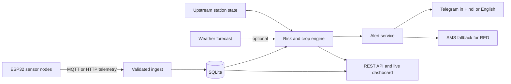

# MausamSahayak

### Hyperlocal weather monitoring, flood-risk alerts, and crop guidance for communities that need local data most

[](https://github.com/manas150309-debug/MausamSahayak/actions/workflows/ci.yml)


MausamSahayak is a B.Tech capstone prototype that combines low-cost field sensors, a risk engine, a live dashboard, and bilingual alerts. It is designed for village- or sub-basin pilots where a regional forecast alone may not capture a fast local rise in water level.

The safety principle is simple: **missing data is never treated as safe data**. A silent node or failed sensor becomes `UNKNOWN`, not GREEN.

> This project supports awareness and preparedness. It does not replace IMD, CWC, NDMA, district authorities, or professional agricultural advice, and it never issues evacuation orders.

## Why this project is different

- **Fail-safe monitoring:** stale readings and sensor faults create a visible `UNKNOWN` state and an alert.
- **Upstream-to-downstream warning:** a rapid rise at an upstream node can escalate risk for a connected downstream node before the downstream level changes.
- **Explainable risk:** every alert includes structured reason codes and the measurements that triggered it.
- **Last-mile delivery:** Hindi and English Telegram guidance, subscriptions, and optional SMS fallback for RED alerts.
- **Graceful degradation:** monitoring continues when the external forecast service is unavailable.
- **Field-ready workflow:** ESP32 firmware, an HTTP/MQTT simulator, calibration instructions, deployment checklists, and a no-hardware demo.

## System architecture



Sensor nodes can report temperature, humidity, pressure, interval rainfall, water level, soil moisture, battery voltage, and signal strength. The backend validates each field, rejects implausible values as missing data, ignores duplicate readings, and evaluates flood and heat risk.

## Quick start without hardware

```bash
git clone https://github.com/manas150309-debug/MausamSahayak.git
cd MausamSahayak

python -m venv .venv
source .venv/bin/activate          # Windows: .venv\Scripts\activate
pip install -r requirements.txt

python -m unittest discover -s . -t . -p "test_*.py"
python -m manas_backend.cli demo
```

Open [http://localhost:8000/dashboard](http://localhost:8000/dashboard). The seeded demo includes:

- a GREEN station with normal readings;
- a RED station with flood conditions; and
- an `UNKNOWN` station that has stopped reporting.

Send a simulated heavy-rain reading:

```bash
python -m nishant_firmware.simulator.simulate \
  --node node01 \
  --scenario heavy_rain \
  --url http://localhost:8000 \
  --api-key dev-key
```

## Risk states

| State | Meaning | Example trigger |
|---|---|---|
| GREEN | No configured warning rule is active | Fresh readings below thresholds |
| UNKNOWN | Safety cannot be determined | Node stale for more than 30 minutes or a required sensor is missing |
| YELLOW | Conditions require attention | Elevated river level, rising level, heavy forecast, or sustained rain |
| ORANGE | High-risk conditions | Rapid rise, intense hourly rain, upstream surge, or near-danger level while rising |
| RED | Severe conditions | Danger mark crossed, flash rise, or upstream surge near danger |

All thresholds in this repository are starting values. A real deployment must calibrate them using local historical events, field measurements, and expert review.

## Main API

| Endpoint | Purpose |
|---|---|
| `GET /health` | Service health |
| `GET /api/nodes` | Registered monitoring stations |
| `GET /api/nodes/<id>/latest` | Latest reading and stale status |
| `GET /api/nodes/<id>/history?hours=24` | Recent station history |
| `GET /api/nodes/<id>/risk` | Flood and heat assessment with reasons |
| `GET /api/nearest?lat=&lon=` | Nearest station and coverage check |
| `GET /api/crop-advice?lat=&lon=&irrigated=0/1` | Rule-based crop suggestions |
| `GET /api/alerts?since_id=` | Alert stream used by the bot |
| `POST /api/readings` | Authenticated HTTP telemetry ingest |
| `POST /api/nodes` | Authenticated station registration |

## Repository guide

| Area | What it contains | Owner |
|---|---|---|
| [`manas_backend/`](manas_backend/) | Telemetry validation, database, API, dashboard, alert generation, and stale-data handling | Manas |
| [`parul_risk_crop/`](parul_risk_crop/) | Flood and heat rules, forecast client, crop adviser, model training, and threshold validation | Parul |
| [`nishant_firmware/`](nishant_firmware/) | ESP32 firmware, simulator, wiring, calibration, power, and deployment notes | Nishant |
| [`swati_bot/`](swati_bot/) | Telegram conversation logic, Hindi and English text, subscriptions, alert delivery, and SMS fallback | Swati |
| [`anil_docs/`](anil_docs/) | Data sources, site selection, budget, evaluation, user trial, KVK review, and capstone documentation | Anil |
| [`deploy/`](deploy/) | Docker Compose, API image, and Mosquitto configuration | Team |

## Verification status

The automated suite currently contains **108 passing tests** covering risk rules, crop advice, forecast parsing, telemetry validation, backend endpoints, alerts, simulator scenarios, bot logic, and documentation tools.

| Component | Current evidence |
|---|---|
| Risk, crop, forecast, validation, and ML pipelines | Unit-tested; validation and ML datasets are synthetic |
| Backend ingest, REST API, dashboard, and alerts | Unit-tested and smoke-tested with a local server |
| Bot conversation, bilingual formatting, alert routing, and SMS logic | Unit-tested, including in-process API integration |
| Telegram transport | Requires a real bot token and live trial |
| ESP32 firmware | Not yet compiled or field-tested on hardware |
| Docker and live MQTT broker | Configuration present; live deployment still to be verified |
| Thresholds and crop ranges | Require local calibration and KVK or domain-expert review |

## Configuration

Copy `.env.example` to `.env`, replace every sample secret, and never commit `.env`.

```bash
cp .env.example .env
```

Important settings include `MAUSAM_API_KEY`, database paths, MQTT credentials, `TELEGRAM_TOKEN`, and the optional SMS provider. See the component READMEs for firmware and deployment instructions.

## Live presentation deployment

The repository includes a Render Blueprint for a reproducible live demo. It runs the real Flask API and dashboard, seeds three presentation stations on an empty ephemeral database, and exposes the scenario simulator while keeping field telemetry writes behind a generated API key.

1. Open [the Render Blueprint setup](https://dashboard.render.com/blueprint/new?repo=https://github.com/manas150309-debug/MausamSahayak).
2. Review the `mausam-sahayak` web service and choose **Apply**.
3. After the health check passes, open `/dashboard` on the generated Render URL.

`MAUSAM_DEMO_MODE=true` is intended only for the public capstone demonstration. Set it to `false` for real deployments so `/api/simulate` and `/api/seed` return `403`.

## Responsible deployment checklist

Before presenting results as field evidence:

1. Calibrate rain, water-level, soil, temperature, battery, and signal readings.
2. Replace all `*_SYNTHETIC.csv` inputs with traceable real datasets.
3. Validate thresholds against dated flood and non-flood events and report false alarms and misses.
4. Obtain KVK or qualified agricultural review for crop ranges and wording.
5. Run a supervised bilingual user trial with at least 10 participants.
6. Test maintenance, power loss, network loss, alert delivery, and recovery procedures.
7. Coordinate any public warning pilot with the responsible local authorities.

## Roadmap

- [ ] Compile and field-test the ESP32 firmware
- [ ] Validate a live MQTT deployment with authenticated node accounts
- [ ] Calibrate thresholds using real IMD, CWC, and site measurements
- [ ] Add Assamese or another locally reviewed language pack
- [ ] Conduct KVK review and a documented user trial
- [ ] Package a repeatable two-node upstream/downstream pilot

## Team

MausamSahayak is a B.Tech Capstone 2026-27 project by **Manas, Parul, Nishant, Swati, and Anil**.

The software is a research and educational prototype. Review the institute's IPR guidance before public disclosure, deployment, licensing, or patent filing.
